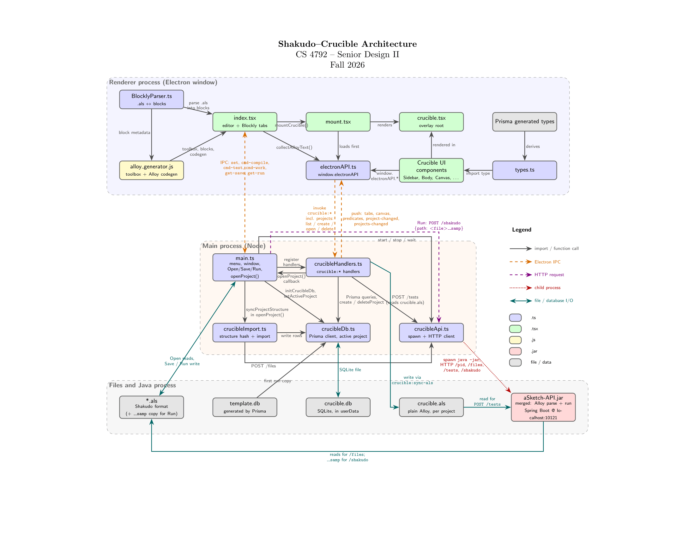

# Shakudo Architecture

This page describes how Shakudo is put together. For an overview and setup instructions, see the [README](../README.md).

## Processes

Shakudo runs as three processes:

| Process | Role |
|---|---|
| Renderer (Electron window) | Blockly editor, text editor, and the Crucible test UI |
| Main (Node) | Windows, menus, files, the database, and the backend's lifecycle |
| Backend (Java) | Spring Boot server on `localhost` that parses and runs Alloy |

The renderer and main process talk over Electron IPC. The main process talks to the backend over HTTP, as the original Crucible did.

A full diagram is in [`architecture.tex`](architecture.tex). The latest version is v1.2:



## Backend Architecture

> This section is being written by the backend team. The headings below are a skeleton to fill in.

The backend is a Spring Boot server (`java/aSketch-API.jar`) that the main process starts at launch and calls over HTTP on `localhost`. It wraps the Alloy Analyzer, which parses and runs Alloy.

### Overview

TODO: components (controllers, services, the Alloy wrapper) and how they relate. A diagram would help here.

### Lifecycle

TODO: how it starts and stops, the port it listens on (currently 10121), the Java version it requires, and what it logs.

### REST API

TODO: one entry per endpoint, with the request body, the response body, and error cases. The endpoints used by the main process today are:

| Endpoint | Method | Purpose |
|---|---|---|
| `/pid` | GET | Health check and process id |
| `/files` | POST | Parse an `.als` file into atoms, relations, and predicates |
| `/tests` | POST | Run an Alloy command against an `.als` file and report whether it is satisfiable |
| `/shakudo` | POST | Run the Shakudo editor's current text (the Run action) |

TODO: confirm this list and the request and response shapes against the source.

### Data Models

TODO: the JSON objects exchanged with the main process, such as atoms, relations, and functions with their parameters.

### Alloy Integration

TODO: how the server calls the Alloy API, how files are parsed, how commands are run, and how errors (compile errors, no instance found) are reported back.

### Building and Testing

TODO: how to build the JAR (`mvnw package`), where the source lives, and how to test an endpoint (for example with `curl`).

## Where your data lives

You don't need to touch these files. To reset the app, delete `crucible.db` and the `projects/` folder.

```
<app data>/crucible/
├── crucible.db          your saved data (SQLite)
└── projects/
    └── <project name>/
        ├── crucible.als   plain Alloy that Crucible reads to run tests
        └── tests/         test files
```

`<app data>` is:

| Platform | Location |
|---|---|
| Windows | `%APPDATA%\my-app` |
| macOS | `~/Library/Application Support/my-app` |
| Linux | `~/.config/my-app` (TODO: update if the data path was moved off NFS homes) |

Your original `.als` files are not stored in this folder. TODO: state whether Save overwrites the original file or a project copy.

## Code layout

| Path | Contents |
|---|---|
| `src/index.tsx` | Sets up the main editor and the Blockly workspaces |
| `src/BlocklyParser.ts` | Parses `.als` files into editable and read-only blocks |
| `src/blocklyContent/` | Blockly block definitions and Alloy code generation |
| `src/crucible/` | The Crucible test UI (React and Mantine) |
| `electron/main.ts` | Windows, menus, file open and save, run |
| `electron/crucibleDb.ts` | Prisma client, projects, and the active project |
| `electron/crucibleHandlers.ts` | IPC handlers for the Crucible UI |
| `electron/crucibleImport.ts` | Imports atoms, relations, and predicates from an `.als` file |
| `electron/crucibleAPI.ts` | Starts the Java backend and sends it HTTP requests |
| `java/` | The backend JAR (`aSketch-API.jar`) |
| `prisma/` | Database schema, migrations, and `template.db` |
| `docs/` | Tutorial, architecture page, and diagram |